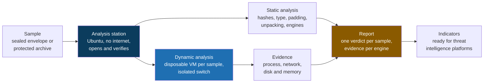

# Sandbox Lab

**A self-hosted Hyper-V sandbox for static and dynamic file analysis, with no upload size limit.**

[Leia em português](README.pt-BR.md)

> The file you most need to look at is usually the one that is too big to upload.

This is the public preview of a project born from years of threat hunting and indicator work. A suspicious file arrives, someone needs to know whether it is safe, and the usual answer is to drop it into a sandbox. Then the sandbox says no. Public and commercial sandboxes cap the upload size, and in practice the real ceiling tends to sit below the advertised one. The installer that matters, the ISO someone downloaded, the 900 MB executable: those are exactly the ones that bounce.

So I built my own. A controlled lab on Hyper-V where the size of a file is a disk question, not a policy question. Static analysis first, dynamic analysis in a disposable machine after, several engines and databases looking at the same sample, open source at the core and room for the private tools a company may hand me.

## The problem

**The size cap is not an accident, and attackers know it.** Inflating a binary with hundreds of megabytes of zeros or junk is a documented evasion technique (MITRE ATT&CK T1027.001, binary padding). It works because the file simply never reaches the sandbox. A size limit that stops the analysis is a gift to whoever built the sample.

**Big files are rarely one file.** Installers, ISOs, MSIs and archives carry dozens of things inside. Scanning the outer wrapper and calling it done misses the one component that actually does something.

**Uploading is not always allowed.** A sample from a corporate environment can carry customer data, credentials or internal documents. Sending it to a third party service may not be an option at all, whatever its size.

**One engine is one opinion.** A single antivirus verdict, or a single sandbox report, is a data point. A decision needs several independent views of the same sample, written down in one place.

## The core idea

Six rules carry the design.

**A clean machine for every sample.** The analysis VM comes from an immutable golden image, and every case runs on its own differencing disk. It boots in seconds, records only what changed, and is thrown away at the end. Nobody reinstalls Windows per sample, and nobody analyzes on a machine that already ran something else.

**Size is handled, not refused.** The engine reads the sample in 1 MiB blocks, so a multi gigabyte file fits on a small analysis station. Padding is detected and stripped into a lean copy that also fits the online services. Containers are opened recursively, with hard limits against decompression bombs and path escapes.

**The sample never sits in the clear on the host.** It travels as a sealed envelope or a password protected archive, and the analysis station is the only place it is opened.

**No internet unless I say so, enforced outside the VM.** The station's network is cut by an access rule on the Hyper-V switch port, not by a firewall inside the guest. Root inside the station cannot undo it, and analysis refuses to start while the internet is on.

**Many engines, one contract.** Every engine receives the file and returns a verdict and findings in the same shape. Open source engines ship in the image. A private tool joins through a command line definition, a small plugin or an API connector, without touching the engine.

**Static alone never says clean.** The verdicts are malicious, suspicious, inconclusive and "no static findings". A sample that detects the VM and stays quiet is inconclusive, not safe.

## How it fits together

The analysis station never executes the sample. It parses, unpacks and asks the engines. Execution happens only inside the disposable test VM, on a private switch that not even the host can see, with the station pretending to be the internet.

## Static analysis

| Step | What it does |
|---|---|
| Identification | MD5, SHA1, SHA256, ssdeep, TLSH, real file type by content, target platform |
| Padding (T1027.001) | finds zero and low entropy regions and produces a lean copy small enough for online services |
| Containers | zip, 7z, rar, ISO, MSI, CAB, tar, gzip, xz, DMG and installers with overlays, opened recursively with limits on depth, file count and total bytes |
| Engines | ClamAV, YARA with community rule sets, capa (mapped to ATT&CK), FLOSS, Detect It Easy, olevba, pdfid, Authenticode verification, PE heuristics, indicator extraction |
| Verdict | malicious, suspicious, inconclusive or no static findings, with the evidence of every engine |

## Dynamic analysis

| Sample | Where it runs |
|---|---|
| Windows (PE, MSI, Office, scripts) | disposable Windows VM on Hyper-V |
| Linux (ELF, shell) | disposable Linux VM on Hyper-V |
| macOS (Mach-O, DMG, PKG) | Apple hardware only, as a remote engine. The macOS license allows virtualization only on Apple hardware, and Hyper-V does not run macOS |

Collection inside the test VM covers process and registry activity (Sysmon, ProcMon), simulated internet with full packet capture inspected by Suricata and Zeek, a memory image for Volatility 3, and a disk comparison done offline, after the VM is powered off, so nothing running inside the guest can hide what it wrote.

## Moving a sample between environments

The preferred path is to replicate the lab where the sample lives. The whole build is code, so the same repository produces the same station on another host.

When moving a sample is authorized, it travels in a sealed envelope. The station generates an RSA 4096 key pair and the private key never leaves it. Sealing runs on a stock Windows machine with the built in PowerShell, using only the public key, so whoever seals cannot open. The content is encrypted with AES 256 and authenticated with HMAC SHA 256 in 4 MiB blocks: a changed byte, a reordered block or a truncated file is rejected before anything is written. The authorization reference is mandatory at sealing time and ends up in the report.

## Built with

| Purpose | Tools |
|---|---|
| Virtualization and build | Hyper-V, Packer, Ubuntu Server 24.04, PowerShell |
| Static engines | ClamAV, YARA, YARA-Forge, capa, FLOSS, Detect It Easy, oletools, pdfid, osslsigncode, debloat |
| Dynamic collection | Sysmon, ProcMon, INetSim or FakeNet-NG, Suricata, Zeek |
| Memory | Volatility 3 |
| Reputation by hash | VirusTotal, MalwareBazaar, CIRCL hashlookup |
| Output | JSON and Markdown reports, MISP export |
| Runtime | Python, PowerShell |

Everything in the core is open source. Commercial engines are optional, by API or by agent, and send only the hash unless I decide otherwise for that engine.

## A few numbers

| | |
|---|---|
| Upload size limit | none, bound by disk |
| Static engines in the image | 10 |
| Ways to plug in a private tool | 3 |
| Container nesting opened by default | 3 levels |
| Envelope key | RSA 4096 |
| Envelope blocks | 4 MiB, each one authenticated |
| Host memory target | 16 GB (station 3 GB, one test VM 4 GB) |

## What this preview is, and what it is not

**In here:** the design, the rules behind it, the architecture and the scope.

**Not in here:** source code, build scripts, the envelope implementation and the step by step guides. The full project lives in a separate private repository.

**Where it stands:** the static engine and the envelope are implemented and covered by unit tests on synthetic, harmless samples. The Hyper-V build is in its first run on real hardware. Dynamic analysis comes next, then memory, then the reputation and private engine connectors. There are no screenshots yet, and they will show up here once a full run exists. Bora.

## About

I am a cloud security consultant working with threat intelligence, security posture and detection engineering. I build these projects to think problems through properly, which for me means writing the design down until it survives being read by someone who was not in my head when I wrote it.

If you want to see the full content, the code or the guides, get in touch: [github.com/Alisson-P](https://github.com/Alisson-P)

## License

This preview is licensed under [Creative Commons Attribution NonCommercial NoDerivatives 4.0 International](https://creativecommons.org/licenses/by-nc-nd/4.0/) (CC BY-NC-ND 4.0).

It is content, not a code release. You may share it with attribution, for non commercial purposes, with no derivative works.

Alisson Pereira / [github.com/Alisson-P](https://github.com/Alisson-P)
