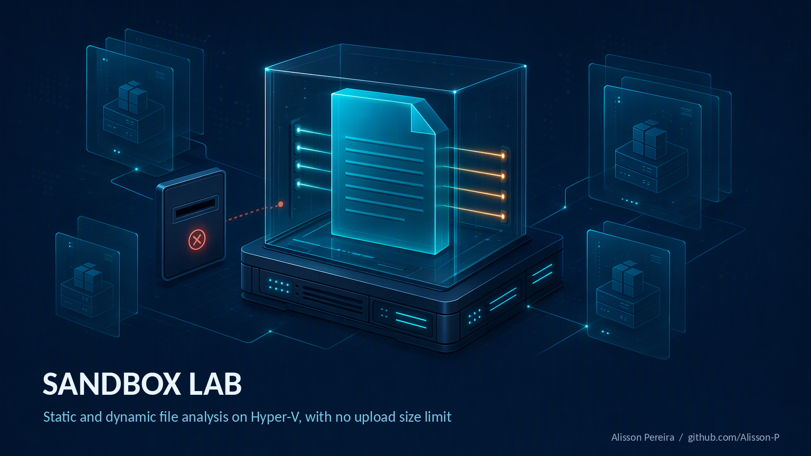
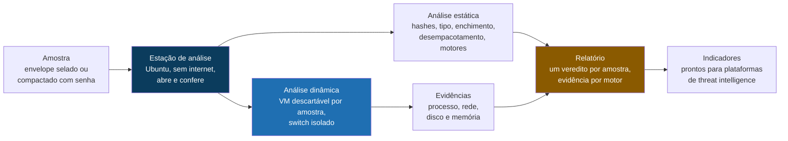

# Sandbox Lab

**Uma sandbox própria em Hyper-V para análise estática e dinâmica de arquivos, sem limite de tamanho de upload.**

[Read this in English](README.md)

> O arquivo que você mais precisa olhar costuma ser justamente o que é grande demais para subir.

Esta é a prévia pública de um projeto que nasceu de anos trabalhando com threat hunting e gestão de indicadores. Chega um arquivo suspeito, alguém precisa saber se ele é seguro, e a resposta de sempre é jogar numa sandbox. Aí a sandbox diz não. As sandboxes públicas e comerciais limitam o tamanho do upload, e na prática o teto real costuma ficar abaixo do anunciado. O instalador que importa, a ISO que alguém baixou, o executável de 900 MB: são exatamente esses que voltam.

Então montei a minha. Um laboratório controlado em Hyper-V, onde o tamanho do arquivo é questão de disco, não de política. Análise estática primeiro, análise dinâmica numa máquina descartável depois, vários motores e bases olhando a mesma amostra, open source no núcleo e espaço para as ferramentas privadas que uma empresa me entregar.

## O problema

**O limite de tamanho não é acidente, e o atacante sabe disso.** Inflar um binário com centenas de megabytes de zeros ou lixo é técnica de evasão documentada (MITRE ATT&CK T1027.001, binary padding). Funciona porque o arquivo simplesmente nunca chega à sandbox. Um limite que impede a análise é um presente para quem montou a amostra.

**Arquivo grande raramente é um arquivo só.** Instaladores, ISOs, MSIs e pacotes compactados carregam dezenas de coisas dentro. Analisar só o invólucro e dar por encerrado deixa passar justamente o componente que faz alguma coisa.

**Nem sempre dá para subir.** Uma amostra de ambiente corporativo pode carregar dado de cliente, credencial ou documento interno. Mandar para um serviço de terceiro pode simplesmente não ser opção, seja qual for o tamanho.

**Um motor é uma opinião.** Um único veredito de antivírus, ou um único relatório de sandbox, é um ponto de dado. Decisão pede várias visões independentes da mesma amostra, registradas num lugar só.

## A ideia central

Seis regras sustentam o desenho.

**Uma máquina limpa para cada amostra.** A VM de análise sai de uma imagem base imutável, e cada caso roda no seu próprio disco diferencial. Sobe em segundos, grava só o que mudou e vai para o lixo no fim. Ninguém reinstala o Windows a cada amostra, e ninguém analisa numa máquina que já rodou outra coisa.

**Tamanho é tratado, não recusado.** O motor lê a amostra em blocos de 1 MiB, então um arquivo de vários gigabytes cabe numa estação de análise pequena. O enchimento é detectado e removido numa cópia enxuta, que também cabe nos serviços online. Pacotes são abertos em camadas, com limites rígidos contra bomba de descompressão e contra fuga de caminho.

**A amostra nunca fica em claro no host.** Ela viaja como envelope selado ou compactado com senha, e a estação de análise é o único lugar onde é aberta.

**Sem internet, a não ser que eu mande, com o corte fora da VM.** A rede da estação é cortada por uma regra de acesso na porta do switch do Hyper-V, não por firewall dentro da máquina. Nem o root lá dentro desfaz, e a análise se recusa a começar com a internet ligada.

**Vários motores, um contrato.** Todo motor recebe o arquivo e devolve veredito e achados no mesmo formato. Os motores open source já vêm na imagem. Uma ferramenta privada entra por definição de linha de comando, por um plugin pequeno ou por conector de API, sem mexer no motor.

**Só a estática nunca diz limpo.** Os vereditos são malicioso, suspeito, inconclusivo e "sem achados estáticos". Amostra que percebe a VM e fica quieta é inconclusiva, não segura.

## Como as peças se encaixam

A estação de análise nunca executa a amostra. Ela lê, desempacota e consulta os motores. A execução acontece só dentro da VM de teste descartável, num switch privado que nem o host enxerga, com a estação fingindo ser a internet.

## Análise estática

| Etapa | O que faz |
|---|---|
| Identificação | MD5, SHA1, SHA256, ssdeep, TLSH, tipo real pelo conteúdo, plataforma alvo |
| Enchimento (T1027.001) | acha regiões de zeros e de baixa entropia e gera uma cópia enxuta que cabe nos serviços online |
| Pacotes | zip, 7z, rar, ISO, MSI, CAB, tar, gzip, xz, DMG e instaladores com overlay, abertos em camadas com limite de profundidade, de quantidade de arquivos e de bytes |
| Motores | ClamAV, YARA com conjuntos de regras da comunidade, capa (mapeado no ATT&CK), FLOSS, Detect It Easy, olevba, pdfid, verificação Authenticode, heurística de PE, extração de indicadores |
| Veredito | malicioso, suspeito, inconclusivo ou sem achados estáticos, com a evidência de cada motor |

## Análise dinâmica

| Amostra | Onde roda |
|---|---|
| Windows (PE, MSI, Office, scripts) | VM Windows descartável no Hyper-V |
| Linux (ELF, shell) | VM Linux descartável no Hyper-V |
| macOS (Mach-O, DMG, PKG) | só em hardware Apple, como motor remoto. A licença do macOS só permite virtualização em hardware Apple, e o Hyper-V não roda macOS |

A coleta dentro da VM de teste cobre atividade de processo e registro (Sysmon, ProcMon), internet simulada com captura completa de pacotes analisada pelo Suricata e pelo Zeek, imagem de memória para o Volatility 3 e uma comparação de disco feita offline, com a VM já desligada, para que nada rodando dentro dela consiga esconder o que gravou.

## Levando a amostra entre ambientes

O caminho preferido é replicar o laboratório onde a amostra está. Todo o build é código, então o mesmo repositório gera a mesma estação em outro host.

Quando levar a amostra é autorizado, ela viaja num envelope selado. A estação gera um par de chaves RSA 4096, e a chave privada nunca sai dela. O selo roda num Windows comum, com o PowerShell que já vem nele, usando só a chave pública: quem sela não consegue abrir. O conteúdo é cifrado com AES 256 e autenticado com HMAC SHA 256 em blocos de 4 MiB. Um byte trocado, um bloco fora de ordem ou um arquivo cortado é recusado antes de qualquer coisa ser gravada. A referência da autorização é obrigatória no selo e vai parar no relatório.

## Feito com

| Para quê | Ferramentas |
|---|---|
| Virtualização e build | Hyper-V, Packer, Ubuntu Server 24.04, PowerShell |
| Motores estáticos | ClamAV, YARA, YARA-Forge, capa, FLOSS, Detect It Easy, oletools, pdfid, osslsigncode, debloat |
| Coleta dinâmica | Sysmon, ProcMon, INetSim ou FakeNet-NG, Suricata, Zeek |
| Memória | Volatility 3 |
| Reputação por hash | VirusTotal, MalwareBazaar, CIRCL hashlookup |
| Saída | relatórios em JSON e Markdown, exportação para o MISP |
| Execução | Python, PowerShell |

Tudo no núcleo é open source. Motores comerciais são opcionais, por API ou por agente, e mandam só o hash, a não ser que eu decida outra coisa para aquele motor.

## Alguns números

| | |
|---|---|
| Limite de tamanho de upload | nenhum, o limite é o disco |
| Motores estáticos na imagem | 10 |
| Formas de plugar uma ferramenta privada | 3 |
| Camadas de pacote abertas por padrão | 3 |
| Chave do envelope | RSA 4096 |
| Blocos do envelope | 4 MiB, cada um autenticado |
| Memória do host prevista | 16 GB (estação 3 GB, uma VM de teste 4 GB) |

## O que esta prévia é, e o que ela não é

**Aqui dentro:** o desenho, as regras por trás dele, a arquitetura e o escopo.

**Fora daqui:** código fonte, scripts de build, a implementação do envelope e os guias passo a passo. O projeto completo mora num repositório privado separado.

**Onde está:** o motor estático e o envelope estão implementados e cobertos por testes unitários com amostras sintéticas e inofensivas. O build em Hyper-V está na primeira rodada em hardware real. Depois vem a análise dinâmica, em seguida a memória, e por fim os conectores de reputação e de motores privados. Ainda não há capturas de tela, e elas aparecem aqui quando existir uma rodada completa. Bora.

## Sobre

Sou consultor de segurança em nuvem, trabalhando com threat intelligence, postura de segurança e engenharia de detecção. Monto estes projetos para pensar os problemas direito, o que para mim significa escrever o desenho até ele sobreviver à leitura de alguém que não estava na minha cabeça quando escrevi.

Se quiser ver o conteúdo completo, o código ou os guias, fale comigo: [github.com/Alisson-P](https://github.com/Alisson-P)

## Licença

Esta prévia está sob a licença [Creative Commons Atribuição-NãoComercial-SemDerivações 4.0 Internacional](https://creativecommons.org/licenses/by-nc-nd/4.0/deed.pt-br) (CC BY-NC-ND 4.0).

Ela é conteúdo, não liberação de código. Você pode compartilhar com atribuição, para fins não comerciais, sem obras derivadas.

Alisson Pereira / [github.com/Alisson-P](https://github.com/Alisson-P)
